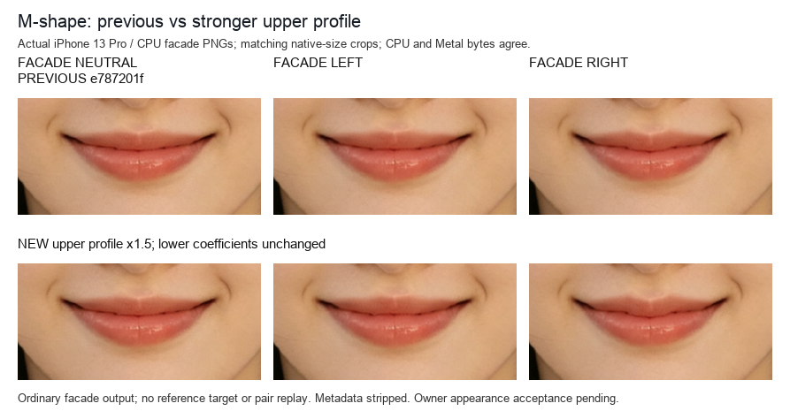

# M 唇：SDK 修复与端点标定

日期：2026-10-17。本页记录旧基线 `c871bfff` 之后的 M11 修复候选及本轮 121 个候选的实际 Swift 同源查询。旧基线的表格与图片保留在[SDK 对照复核](SDK对照复核.md)，不能作为本页 M11 的渲染结果。

本页前半部分记录 `e787201f` 的 M11 参考校准事实；该版后续实际真机与像素验证见[公共修复记录](../M唇与丰唇修复记录.md)。所有者认为效果可见但偏弱后，新增的可见度调整另见页末。历史参考误差不代表增强版误差；所有者后续确认本轮嘴部功能暂定按当前版本收尾，见[人工验收](../人工验收.md)，不据此认定全部参考差异消除。

## 本轮能约束什么

参考仍是 `IMG_1969 → IMG_1970` 的左端→右端总差，没有共同零态或中间档。选用正负对称的设计响应，以及把它拆成两个设计端点，均不属于实测中性状态或实测单端强度。这里的系数是这一前向模型的端点跨度标定值，也不是闭源应用算法的还原声明。

运行使用从真实原生检测导出、完整往返核对的同一份源几何，在实际 Swift `BeautyContinuousMouthMap` 中重新经过证书准入、低端逆解和高端前向映射。对观测源点 q 比较：

```text
p = inverse(F_low, q)
V_sdk(q) = F_high(p) - F_low(p)
```

没有用 Python 替代 SDK 位移。原始点索引到实际预览物理像素的转换保留完整的 `+0.5 / -0.5` 像素中心约定；向量只按实际横纵尺度换算，不加中心偏移。下文残差单位均为对齐截图照片像素，不是相机像素；局部坐标、源唇缝和最终原图单次采样仍遵循[公共约定](../实现公共约定.md)。原像素、实际对应坐标、逐点查询和中间场仅保留在被忽略的本地测量资料中。

## 从三波简化到 M11

旧基线能够给出中央正、两肩负的主要方向，但下缘反向峰过强、上下面部弱尾不足；外侧还存在被简化模型漏掉的“弱正→嘴角负”。将中央幅度整体放大，会同时加重近唇缝与下缘误差。

M11 在源嘴宽归一化坐标中使用 11 个有序节点：两端归零、两嘴角负峰、两外侧弱正峰、两肩负峰，以及中央三个正节点。它是七个主要符号波瓣的连续剖面，不是 11 个独立运动部件。相邻节点以五次平滑函数连接，节点处导数为零，完整支撑保持 C1。新增中央正肩使正区宽度能独立于两肩负峰位置调整。

在曲唇缝坐标 `t = v - m(s)` 中，当前场可写为：

```text
D(s,v,u) = u · E_source(s,v) · E_tissue(s,t)
           · (0, P_11(s) · E_profile(s,t) + a_lower · B_lower(s,t))
```

`E_profile` 只限制上层波形；下缘局部峰 `B_lower` 有自己的幅度与支撑，不再把一条长上层尾带到整片下唇。公共 tissue 支撑包含这两个分量的独立支撑，绝对源包络 `E_source` 再保护本次源几何中的鼻眼区域。源局部横向位移设为零是本轮低自由度设计；它不是水平分量实测严格为零的声明。

下缘峰采用横纵两个紧支撑四次 bell 的乘积。中心与纵向半径跟随源下唇深度，横向半径跟随源嘴宽，因此减幅、缩窄和弱下尾可以分别核对，不固定到截图上的某几处位置。

保护边界采用有限宽度 C1 过渡。设当前源上边界为 `top`、物理保护边界为 `protectedTop`、上尾长度为 T：

```text
a = max(protectedTop, top - T - 0.10)
b = max((a + top) / 2, top - 0.65 T)
```

绝对源包络在 a 及以上为零，从 a 到 b 连续升起，到源上唇边界 top 已进入平台。该过渡按可用源间距生成，避免保护截短上尾后把羽化夹成极窄 epsilon。全部包络导数都进入现有 M 唇纵向导数证书；没有为了幅度移除证书或降低逆残差要求。

## 保留的归一化系数

W 是每次请求的源嘴宽；U、L 是当前源上、下唇相对唇缝深度。表中位移系数与横向位置以 W 为单位，U/L 倍数按本次源几何计算。它们是有限候选族中选出的设计系数，不表示参考观测具有六位小数的精度。

| 分量 | 保留值 |
| --- | --- |
| 中央、肩、外侧弱正、嘴角位移系数 | `+0.007176 / −0.004236 / +0.0022 / −0.003041` |
| 中央正肩半宽、相对中央高度 | `0.07224 W / 0.65592` |
| 两肩、外侧正峰、嘴角、零支撑位置 | `±0.1508 / ±0.35 / ±0.54 / ±0.78 W` |
| 上层上尾长度 | `0.30 W` |
| 上层平台下界、下方归零深度 | `−0.20 U / +0.43056 L` |
| 下缘独立位移系数 | `−0.00392 W` |
| 下缘中心深度 | `1.0584 L` |
| 下缘横向、纵向半径 | `0.11952 W / 0.5684 L` |

这些值保留在 `main` 分支仓库相对路径 `BeautySDK/Sources/BeautyEffects/Render/BeautyMouthMShapeConfiguration.swift` 的 `referenceCalibration`。按约五至六位小数取整，其中嘴角系数由本轮候选值四舍五入；下列结果对应本轮候选的实际查询，后续独立的新鲜原生检测与最终像素验证见[公共修复记录](../M唇与丰唇修复记录.md)。宽度设为零的 M9 对照仍可由参数显式构造，未将它当作当前默认。

## 固定源分区与候选选择

共保留 1035 条方法记录、679 个不同源中心：原基础对应 274 条、原强化对应 136 条，以及新增 15/21 像素模板的 290/335 条。它们有重复中心与重叠模板，不能当作 1035 个独立样本，也不是跨人脸数据集。

源空间分块在选型前冻结：99 个不同源中心用于 train、115 个用于 holdout、465 个位于模板边界 guard；对应方法记录为 139/182/714 条。只用新增 21 像素模板的 41 条 train 和 107 条预先声明机制区域 guard 参与选择，holdout 不参加候选评分。guard 在此是显式标定约束，不能再称为未参与拟合的独立验证。

评分按 14 个固定源区域平衡向量均方误差；train 行权重为 1、guard 为 0.5。区域覆盖权预先设为 `min(1, 不同源中心数 / 3)`，避免一个稀疏点与稠密区域等权，并另有小的固定参数偏移先验。候选只来自有限的幅度、范围和中央正肩对照，共执行 121 个不同候选，没有根据 SDK 残差重选对应或扩大搜索到无限自由度。

guard 模板与 holdout 的纹理足迹可能重叠，若干关键峰、肩部和近缝区域又缺少充分独立留出。因此这是固定的优化 holdout，**不是盲测资格，也不能证明每个峰都通过独立留出验证**。上尾长度、平台下界等最优值接近本轮预设范围边界，也不证明找到了所有模型中的全局最优。

## 实际同源结果

以下都是向量残差 RMSE；旧基线列对应 `c871bfff`，M9 是本轮已修正有限保护羽化但尚无中央正肩的对照，M11 是本轮选型候选。背景没有被用来代替活动区域检查。

| 查询集合 | 旧基线 | M9 | M11 |
| --- | ---: | ---: | ---: |
| 全部 1035 条方法记录 | 0.991 | 0.494 | 0.458 |
| holdout 182 条方法记录 | 0.871 | 0.709 | 0.611 |
| 新增 15 像素模板，290 条 | 1.084 | 0.550 | 0.540 |
| 新增 21 像素模板，335 条 | 1.090 | 0.525 | 0.477 |
| 原 29 像素模板，274 条 | 0.635 | 0.328 | 0.303 |
| 原强化 21 像素模板，136 条 | 1.108 | 0.562 | 0.479 |

新增两种模板的活动/近静止分类均由参考位移决定，未按 SDK 表现重分组。15 像素模板活动 113、近静止 177 条，残差 P95 从 `2.30 / 1.88` 降至 `1.45 / 0.85`；21 像素模板对应 118/217 条，从 `2.46 / 2.00` 降至 `1.30 / 0.83`。这些残差仍含参考匹配的不确定性，不能当作未知真实位移的精确误差。

| 固定源区域 | 参考 dy 中位，15/21 模板 | M11 dy 中位，15/21 模板 | 结果 |
| --- | ---: | ---: | --- |
| 中央窄峰窗口 | +4.96 / +4.47 | 约 +4.22 | 比旧基线约 +3.82 更接近，尖峰仍偏弱 |
| 中央近缝 | +3.03 / +3.09 | +3.27 / +3.27 | 比旧基线收敛，局部仍非完全吻合 |
| 左肩 | −2.08 / −1.98 | −1.88 / −1.86 | 保留正确上移，幅度更接近 |
| 右肩 | −2.10 / −2.14 | 约 −2.06 | 保留正确上移 |
| 中央下唇中段 | +0.12 / +0.18 | 约 0 | 保留近静止，不代表整片下唇实测固定 |
| 中央下缘 | −1.12 / −0.75 | −0.92 / −0.63 | 去掉旧基线过强与过宽作用 |
| 上方皮肤尾 | +1.65 / +1.99 | +0.29 / +0.58 | 仍明显不足，含下述保护折中 |
| 下方皮肤尾 | −0.38 / −0.20 | −0.30 / −0.12 | 弱尾恢复 |

中央宽正区中 M9 出现的一处弱反号在 M11 消失，新增 21 像素模板的上唇核心 RMSE 从 M9 的 1.076 降到 0.646。不能只报这一改善：新增 15 像素模板同区由 0.846 小幅升到 0.885，原 29 像素模板 holdout 由 0.383 升到 0.401，均完整保留；后者仍低于旧基线 0.669。局部宽正区还有约 1 像素的不足。

外侧弱正段的参考活动点在两种新增模板中均已恢复同号，嘴角及外侧负位移由旧基线近零恢复到约 −1.5…−1.65。正确方向不代表局部幅度全过：左侧弱正段仍有多个点弱于参考，右嘴角区域残差 P95 仍约 1.17。下缘和下方弱尾保留 M9 的改善：下缘 P95 从旧基线 `3.29 / 3.48` 降到 `0.86 / 0.42`，下方皮肤尾从 `0.93 / 0.80` 降到 `0.21 / 0.17`。

## 上方弱尾与保护折中

在原有上方皮肤观察窗的 44 条方法记录中，实际低端逆解得到的源点有 14 条在物理保护边界上方或边界处、29 条位于源包络羽化区、1 条进入平台。分类使用真正的 Swift 逆解源点，没有把参考点的位置或 SDK 残差当作边界。

新增 15/21 模板各有 5 条落在物理保护上方：参考 dy 中位约 +0.42/+0.41，而 SDK 为零。只作诊断地移除绝对源包络后，同类 SDK 中位反而约 +2.03，明显超过这段弱尾，不能以取消保护来追幅度。

在保护下方，模板取到的源位置分布不同。15 模板的 9 条羽化记录参考中位约 +2.41、SDK +0.81；21 模板的 13 条记录参考约 +2.42、SDK +2.35。相同实际源点上的包络响应比显示，部分位置仍被明显压低，而接近平台的位置已大体保留。这既解释了残差，也限制了“整个上尾同倍率不足”的推断。当前保留有限过渡与保护，记录剩余弱尾折中；没有通过提高所有波峰、放宽真实证书或让鼻眼随动来消掉汇总误差。

本轮所有 121 个候选均完成实际映射查询；选中候选低、高端安全缩放均为 1，全部 1035 查询成功，最大低端逆残差小于 `0.0001` 个实际预览像素。该数值只说明逆求解满足本轮门槛，不是参考匹配精度。最终 fresh native 门面、CPU/Metal 输出、鼻眼保护窗口和所有者外观验收仍需完成；本页不把同源数学标定写成已验收或已完整复现。

## 所有者反馈后的可见度调整

2026-10-17，所有者确认 M 唇已经可见，但要求更明显。原 `referenceCalibration` 保留上文全部系数及 `profileGain=1`；生产默认改用 `ownerPreferredCalibration`，将完整上层 M11 剖面的所有节点纵向幅度统一乘以 **1.5**。下缘反向峰系数、位置、宽度、支撑及保护包络不改，丰唇、白牙也未修改。这是所有者可见度偏好，不是新的参考测量或重新拟合。

增益在 `Profile` 构造之前应用，因此位移界和完整导数界自动包含这 1.5 倍；没有在准入后放大位移。一般输入仍按原证书获得安全系数，不能保证所有更窄的保护间距也能保留完整增益；共享 M 场的安全缩放可能同时影响独立下缘实际幅度。

本轮仅运行 M 唇及其直接调用、组合逆解相关的 **15 项定向测试，全部通过**。新增两项检查同一源点的上层 D/J 增至 1.5 倍、下缘 D/J 不变，以及源保护边界仍严格为零。没有例行重跑前版 112 项或全 SDK。

同一 iPhone 13 Pro 上，对本次闭嘴源图重新执行一次生产 MediaPipe 478 点检测，获得 12 组实际 CPU／Metal 门面输出（零值、左端、1/4、3/4、右端、归零）和 1,035 稀疏＋4,941 网格同源查询，失败 0。CPU／Metal 逐字节一致，源图、alpha、归零和指定眼鼻／外颊保护窗检查通过；最大逆回代残差 `9.91823e-5` 预览像素。全部非中性 M 帧的安全系数均为 1，增强没有被抵消。

按前版冻结的源分区，中央峰部 21 条对应的低端→高端 dy 中位数由 **4.2166 增至 6.3249 原照片像素**；左右肩的中位数约由 −1.858／−2.060 变为 −2.851／−3.115。固定低端查询 q 下，逆解源点会改变，故不要求所有端点总差都严格等于 1.5 倍。下缘 45 条及下方皮肤尾 51 条查询与前版完全一致；下唇中部部分靠近上层支撑的查询仍有少量随动，不能扩大成“整片下唇完全不动”。

测试探针和插件已恢复移除，普通 App 保留数据覆盖安装并打开同一闭嘴照片，供所有者继续验收。后续如再调整可见度，应继续区分用户偏好、原参考端点事实及实际安全准入。

## 本地实际输出图证

下图使用同一输入、同一原尺寸嘴部裁剪，行分别为前版 `e787201f` 与上层增益 1.5 的新版，列为普通 facade 的零值／左端／右端；CPU／Metal 字节一致。它是实际输出可见度对照，不是参考高端重建图。


