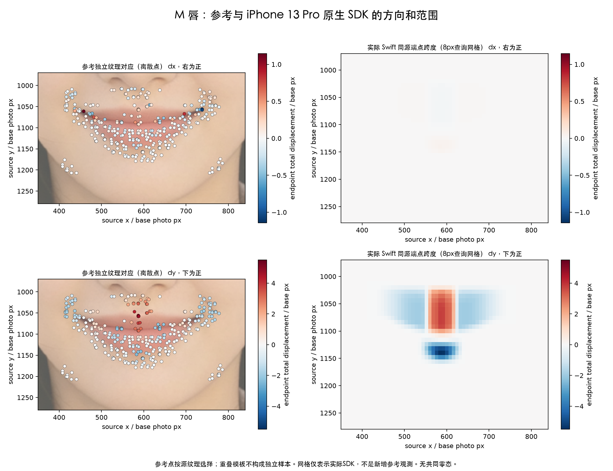
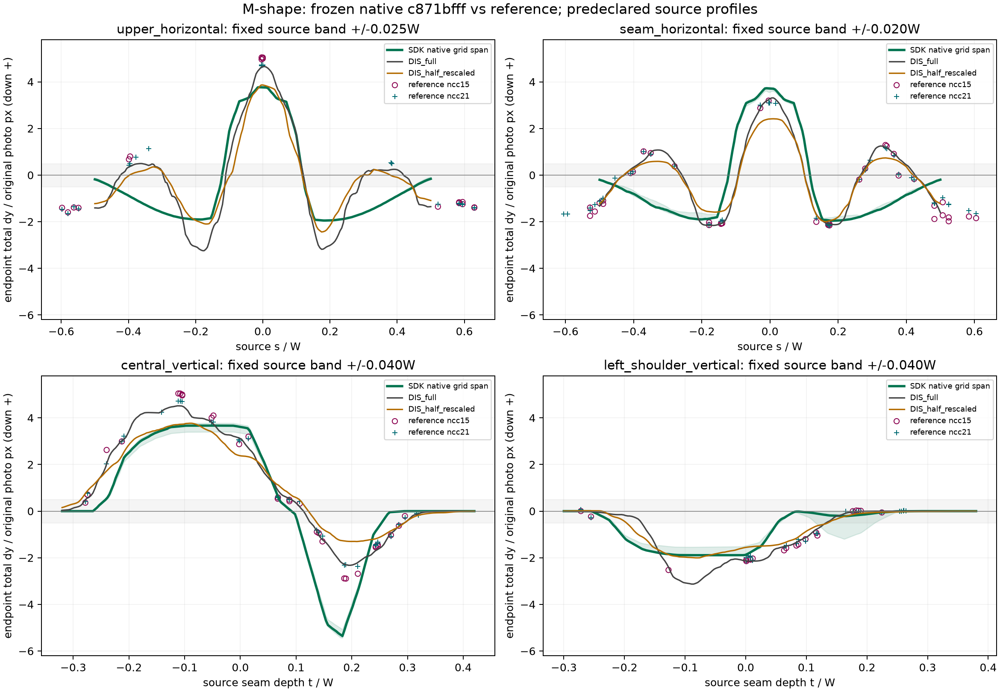
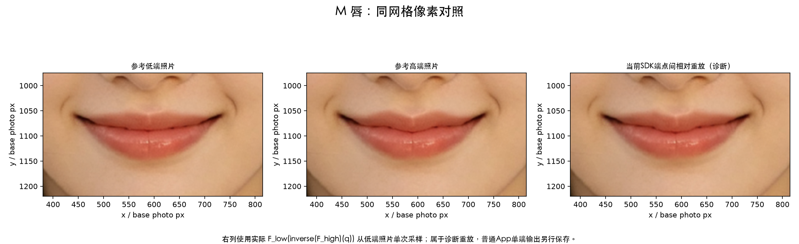

# M 唇：幅度、方向与作用范围复核

日期：2026-10-17。被核对代码 `c871bfff`。输入、同源映射、像素中心、真机执行及限制见[本轮公共记录](../M唇与丰唇对照复核.md)。这里比较参考低端→高端总差，dy 向下为正，单位为对齐截图照片像素。

**主核心方向正确，但横向外侧反号，下缘过强，上下皮肤尾截短，不能整体加幅。** 本轮没有修改模型，以下是可推翻现有简化的证据与后续约束。

## 参考证据复核

预先固定 758 个源纹理空间候选；15×15 模板接受 290，21×21 接受 335。15 模板初拒绝为弱纹理 396、歧义 65、搜索触边 3、反向闭合 4；21 模板分别为 343、74、3、3。各自三个触边点扩大搜索后均因歧义继续拒绝，没有删去不利对应。

两种模板有 275 个共同源中心，方法差异 P95 为 0.421 px，11 点超过 0.5 px、4 点超过 1 px；没有按这种一致性筛点。零变化控制接受 338 点，位移 P95 为 0.104 px；已知小平移控制接受 19/40，误差 P95 为 0.661 px。这些控制检验方法能力与符号，不能外推成真实变形精度。

分区只取源纹理和源唇缝相对坐标；唇缝定位按 ±4 px 改动检查敏感性。旧的“中央九点”观察窗混有上方皮肤，不能全部当作红唇内部。新增分层把上唇核心、近缝、下唇中段、下缘和皮肤分开。

## 同源 SDK 对照

以下两列参考中位数对应 15/21 两种模板；SDK 同样保留两组记录，不把它们合并成更多独立样本。

| 固定源区域 | 参考 dy | 当前 SDK dy | 判断 |
| --- | ---: | ---: | --- |
| 中央上缘局部峰 | 约 +4.7…+5.0 | 约 +3.81 | 在纹理约束下偏弱；不是连续全域峰值资格 |
| 中央近唇缝，中位 | +3.03 / +3.09 | +3.65 / +3.70 | 已偏强约 0.6 px |
| 左肩，中位 | −2.08 / −1.98 | −1.53 / −1.53 | 上移不足 |
| 右肩，中位 | −2.10 / −2.14 | 约 −1.96 | 较接近，仍非完全一致 |
| 中央下唇中段，中位 | +0.12 / +0.18 | 约 0 | 大体近静止，不能据此固定整片下唇 |
| 中央下缘，中位 | −1.12 / −0.75 | −3.52 / −3.48 | 反向过强，且覆盖过宽 |
| 上方皮肤尾，中位 | +1.65 / +1.99 | +0.21 / +0.36 | 衰减过早 |
| 下方皮肤尾，中位 | −0.38 / −0.20 | 约 0 | 弱尾缺失 |

中央上核心活动点两种模板分别 14/14、12/12 同号，左右肩也全部同号。中央下唇中段两种模板各 20 点，参考分别 19/20、20/20 位于 ±1 px 内；SDK 中位约零但仍有个别约 1.58 px，不能宣称整段严格固定。

下缘反向局部点的参考约 −2.31 px、SDK 约 −5.30 px；这一约 2.3 倍的局部过强不代表所有下缘点同倍率。下缘区域中参考不足 1 px 的 7/12 个方法点，SDK 反而有约 3.23/3.04 px 的位移幅度中位数。源唇缝边界 ±4 px 敏感性检查不推翻下缘过强的结论。

横向外侧还遗漏了两次符号变化：

- 源嘴宽约 0.28…0.42 的侧部近缝带，参考有弱正 dy，约 +0.74…+0.94 px；SDK 中位约 −0.89…−1.13 px。按参考幅度≥1 px 的活动诊断，左侧每种模板 7/7、右侧 4/4 与 5/5 都反号。
- 再向嘴角及外侧，参考中位约 −1.4…−1.7 px，SDK 仅约 −0.04…−0.08 px，已近归零。这些是局部证据，不能由离散点反推精确全支撑边界。

原三波归零方案是简化，不能再把“中央正、两肩负”当作完整参考模式。水平分量整体小于竖向，但并非实测严格为零；本轮保留 dx 对照，未据弱小分量增加自由参数。

## 残差与改造约束

新增 15/21 模板的活动点分别 113/118，向量残差 P95 为 2.30/2.46 px；近静止点为 177/217，残差 P95 为 1.88/2.00 px。原强化 136 点仍完整保留，活动 53、近静止 83，对应 P95 为 1.85/2.25 px。残差包含匹配不确定性，不能称真值误差；背景平均数不能证明唇部复现。

后续应分别处理横向波形、纵向包络和下缘反向分量：中央上缘需要增强，近缝需要收敛；下缘需要减幅及缩小过作用，上下皮肤弱尾需要保留，外侧需要恢复被证据支持的再次变号。必须同时检查源几何定位与实际安全缩幅；不能把上述局部倍率直接乘到标称系数，更不能以去掉安全约束换幅度。实际同源查询与未参与拟合的源分区应重新核对，不能只看生成图自然或代码单测通过。

## 图示

剖面中的 SDK 曲线由实际 Swift 查询网格插值，参考稠密曲线是窄带统计，散点才是各模板接受的邻近纹理对应。半尺度平滑场削弱中央和下缘峰，不能任选一条曲线作为连续真实极值。

