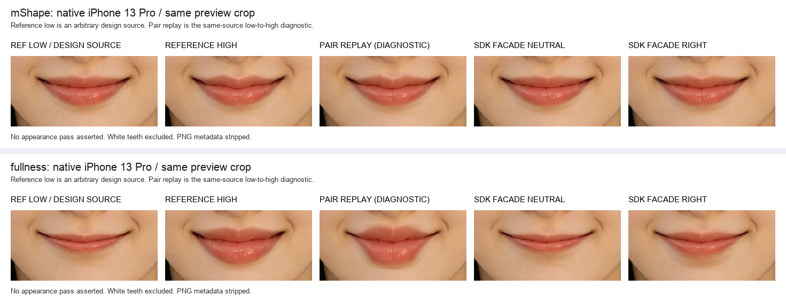

# M 唇与丰唇：模型修复与真机交付

日期：2026-10-17。分支：`codex/mouth-displacement-analysis-20261016`。本轮继续修复 `57c42945` 之后的两项模型；原 `c871bfff` [基线复核](M唇与丰唇对照复核.md)保留供比较。白牙未修改，其他六项嘴部控制的参数未改。

两项已接入校准后的默认配置，并安装至所有者的 iPhone 13 Pro。**这是可供所有者验收的修复版本，尚未取得参考外观完全复现或人工验收资格。**

## 模型变化

- M 唇恢复独立中央正区宽度，以 11 个源口宽归一化节点表达中央、两肩、外侧再次变号及嘴角；上层与局部下缘反向峰分别衰减。绝对源坐标保护过渡按可用间距构造，避免极窄羽化把安全系数压到近零。详见 [M 唇修复标定](M唇/SDK修复标定.md)。
- 丰唇将绝对眼鼻保护与弯曲唇缝距离分开；增加从唇缝到观察唇深的连续响应，以及上下唇不同的横向支撑。完整导数包含深度、横向混合和源保护的乘积项。列单调证书使用连续区间及局部唇缝范围，保持正负端点的全域可逆条件。详见 [丰唇修复标定](丰唇/SDK修复标定.md)。
- 两项继续从同一原始 RGBA 求完整逆映射并采样一次；不反复变形上次输出，不加入保存的人脸点位或图像专用屏幕坐标。

## 最终实际真机复核

设备为 iPhone 13 Pro、Apple A15 GPU、iOS 26.4.2；沿用现有签名和 `com.yakang.wanneng1`。每个参考低端源图经过实际 `PhotoRenderer.load`，预览为 699×960，分别执行新鲜的生产 MediaPipe 478 点检测，再走实际 BeautyEngine CPU／Metal facade。原生观测在请求内固定，不使用手工轮廓。

| 本轮实际检查 | 结果 |
| --- | --- |
| 两图 × 两后端 × 零值、左端、1/4、3/4、右端、归零 | 24 组输出，失败 0 |
| 固定参考同源查询 | 1,359 稀疏 + 9,882 网格，失败 0 |
| 最大低端逆回代残差 | `9.93442e-5` 预览像素 |
| 实际 facade 与独立完整映射输出、CPU／Metal 对照 | 逐字节一致 |
| 源图、alpha、尺寸和归零 | 检查通过 |
| 鼻、眼、左右外颊的四个指定保护窗 | RGBA 逐字节不变；另报告的下巴窗也不变 |
| 原生与 macOS 同源校准向量 | M 最大差 `0.000118` 原图像素，为系数舍入量级；丰唇最大差 `<4e-13` |

这里的 CPU／Metal 嘴部路径共享源域 CPU 采样器，因此一致性不是两个独立形变算法的相互验证。保护结果只覆盖指定窗口，不扩大成整个解剖区域或全脸。

## 与冻结参考的最终差异

以下是 1170×1608 对齐照片网格上的低端→高端总差，不能解释成已测得的单端强度。

| 观测 | 基线 → 修复版 |
| --- | --- |
| M 唇新 21px 模板向量 RMSE | `1.090 → 0.477px` |
| M 唇新 15px 模板向量 RMSE | `1.084 → 0.540px` |
| M 唇两方法中明显反向的活动对应 | `15／13 → 0／0`；仍存在弱响应，不能写成全部对应都重现 |
| 丰唇 67 个缩放纹理对应向量 RMSE | `2.215 → 1.684px` |
| 丰唇全部 22 个活动材质对应向量 P95 | `9.124 → 5.614px` |
| 丰唇全部 260 个近静止材质对应向量 P95 | `0.317 → 0.366px`，有小幅退化 |
| 丰唇中央五列高度比中位 | `1.873 → 2.279`，参考 `2.298` |
| 丰唇固定参考列轮廓绝对 y 残差 P95 | `15.672 → 6.574px`；36 条可比，6 条范围外保留，禁止外推 |

M 唇仍有受保护上方皮肤尾的幅度折中。丰唇的侧上缘、部分上唇纹理及近缝点仍有偏差，215 个普通模板诊断的 RMSE 从 `1.106` 小幅变为 `1.121px`；详见逐项标定文档的改善和退化数据。轮廓约束不是材质对应，不能给同列探针虚构 dx=0。重叠模板、三种轮廓定位设置也不能计作独立样本。

M 唇优化保留预先按源空间划分的拟合、guard 和复核角色；丰唇原单个下方尾点经多轮观察后明确改为机制约束参与拟合，原角色仍保留记录，其余空间复核集合未直接拟合。这些复核数据已经被观察过，不称盲测或跨人脸泛化验证。

## 局部测试与交付边界

相关定向测试最终 **112 项通过，1 项显式 opt-in 本地八图复核跳过**，未运行全 SDK 回归。覆盖两项配置、完整导数和区间界、闭嘴准入、八项映射的直接组合、逆解、负例、resolver 和引擎调用路径。初跑 113 项中，连续性测试的两条误差界断言失败；修正后单独重跑该文件的 4 项，全部通过。未重复累计已通过项，未用旧八图产物补算跳过项。

连续性测试曾把目标回代残差直接当成源点误差下界。修正为使用每次实际残差乘以逆映射 Lipschitz 界，并计入当前及上一档误差；同时新增实际回代残差仍不超过原 `1e-4` 预算的断言。生产逆解预算和安全条件未放宽。

最终原生测试结束后恢复普通 App，移除自有测试探针、测试 bundle 和临时原生点位导出，保留应用数据及两张授权源输入。普通 App 已完成严格签名核验、安装和启动，打开本次闭嘴参考照片。测试缓存、聚合结果和必要对照证据保留在本地。

参考没有共同零态或中间档。相对端点重放用于诊断总差，不能冒充普通 facade 的右端图。最终仍由所有者在实际 App 中验收方向、幅度、范围与触感；本轮不代签人工验收。

## 后续 M 唇可见度增强

所有者认为 M 唇可见但偏弱后，仅将上层 M11 剖面增益从 1 提高至 1.5，下缘峰系数、几何支撑、丰唇与白牙保持不变。原参考校准系数单独保留；上文参考误差表属于 `e787201f`，不冒充增强版参考拟合结果。

本次 15 项 M 唇相关定向测试通过；新鲜单图原生检测、12 组实际 CPU／Metal 输出及 5,976 条同源查询失败 0，M 安全系数保持 1，指定保护窗与归零检查通过。中央峰部端点总差中位数约由 4.22 增至 6.32 原照片像素，所测下缘与下方皮肤尾保持前版结果。普通 App 已更新到同一 iPhone 13 Pro；完整范围和共享安全缩放限制见 [M 唇可见度调整](M唇/SDK修复标定.md#所有者反馈后的可见度调整)。最终外观继续由所有者验收。

## 本地真机对照图证

下图分别列出参考低端、参考高端、同源端点相对重放、普通 facade 零值和右端。相对重放仅用于诊断低端→高端总差，普通右端不是已知共同零态下的参考高端重建。M 唇这一张是增强前 `e787201f` 的两项修复版本，后续上层增益 1.5 的实际输出见 [M 唇增强图证](M唇/SDK修复标定.md#本地实际输出图证)。

