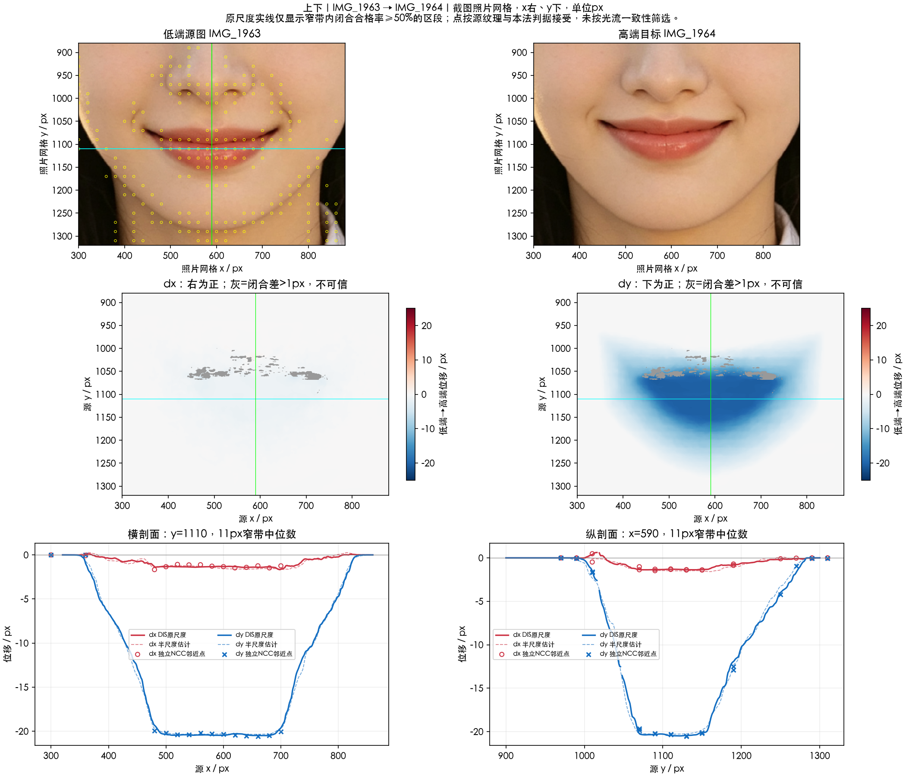

# 嘴唇上下

实施状态更新（2026-10-17）：本项已接入 SDK 候选改造，外观待所有者验收；当前实现与实测限制见[SDK改造记录](../SDK改造记录.md)及[人工验收](../人工验收.md)。原测量结论保留如下。

本轮依据 `IMG_1963.PNG → IMG_1964.PNG`，测量“上下”滑杆左端到右端。**右端相对左端上移**，并带有较小的向左分量。下部可靠纹理呈近恒定位移，外围连续衰减。

分析日期：2026-10-16。截图像素中 `+dx` 向右、`+dy` 向下；稳定区原字节一致，无重采样。没有共同中性原图，不能把端点总移动除二当作单端强度。

| 观测集合 | 独立 NCC 点数 | dx 中位数 | dy 中位数 |
| --- | ---: | ---: | ---: |
| 中央唇邻域 | 14 | −1.34 | −20.29 |
| 下部唇邻域 | 26 | −1.34 | −20.31 |
| 按源色素与下半部选择的子集 | 36 | −1.34 | −20.34 |

下半部子集平移残差中位 0.25、P95 0.57 px，支持局部平台平移。上缘可独立匹配点少，且源色素选择会带入过渡皮肤；不能把全体选点拟合成仿射后，直接断言整个嘴唇压缩或整体刚性。

- [分析链路](分析链路.md)：统计、平台资格与保护边界。
- [实现方案](实现方案.md)：尚未实施的二维平移平台及反证方法。
- [本地测量说明](本地测量说明.md)。
- [公共坐标与采样约定](../实现公共约定.md)。

未修改 SDK；本轮没有证明参考复现、中性强度或一般照片上的效果。
