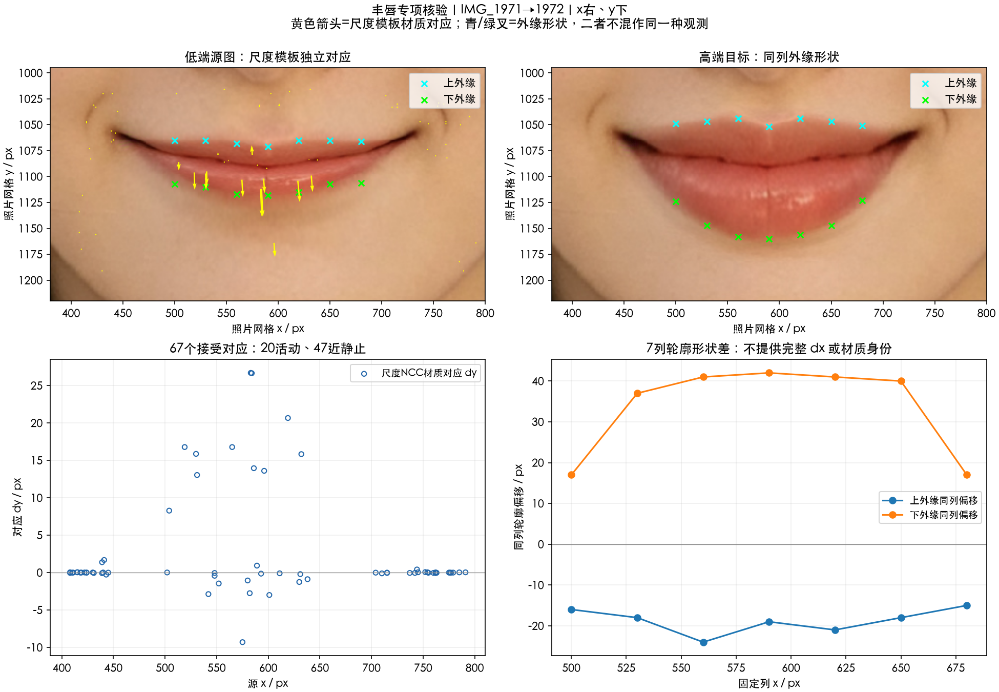

# 丰唇

实施状态更新（2026-10-17）：本项已接入 SDK 候选改造，外观待所有者验收；当前实现与实测限制见[SDK改造记录](../SDK改造记录.md)及[人工验收](../人工验收.md)。原测量结论保留如下。

最新[真机幅度、方向与范围复核](SDK对照复核.md)：竖向主扩张方向吻合，但中央厚度不足、部分侧边与下方皮肤过作用，小水平分量未复现；当前仍需分区校准。

[返回嘴唇入口](../README.md)。分析日期：2026-10-16。

参考为 `IMG_1971 → IMG_1972`，工具栏名称为“丰唇”，对应滑杆左端→右端。端点未显示数值；没有共同零态与中间档，不能把端点总差拆成两个单端强度。

**主要结论：端点差以唇缝附近为相对稳定带，上下外缘反向远离，下唇的外扩更大。** 七条同列轮廓剖面的上外缘偏移为 −24…−15 px，下外缘为 +17…+42 px；外缘间高度比为 1.79…2.38。依据源唇缝区分的下唇十个缩放模板对应向下 8.28…26.70 px，水平分量为 +0.12…+1.95 px。轮廓差与纹理对应是两种证据，不能互相冒充。

本组变形较大，DIS 光流在唇部前后向闭合 P95 为 20.31 px，强化独立活动点与 DIS 的差异 P95 为 13.57 px。**热图只保留空间线索，不把其峰值当作可靠实测最大位移。** 最小候选为上下不对称、沿唇宽收束的竖直扩张；单一刚性平移与统一等比放大均不足以解释这些观察。

- [分析链路](分析链路.md)：输入、对齐、独立对应、轮廓检查和未知量。
- [实现方案](实现方案.md)：候选前向场、标定与可推翻的验收方法；尚未实施。
- [本地测量说明](本地测量说明.md)：材料、接受/拒绝统计与复测边界。
- [位移证据](证据/位移证据.png)：本地保存的对照、估计场和剖面；图像遵循项目忽略规则。

只完成本组参考的几何分析与候选方案，没有修改 SDK、宿主或运行构建、模拟器回归。

