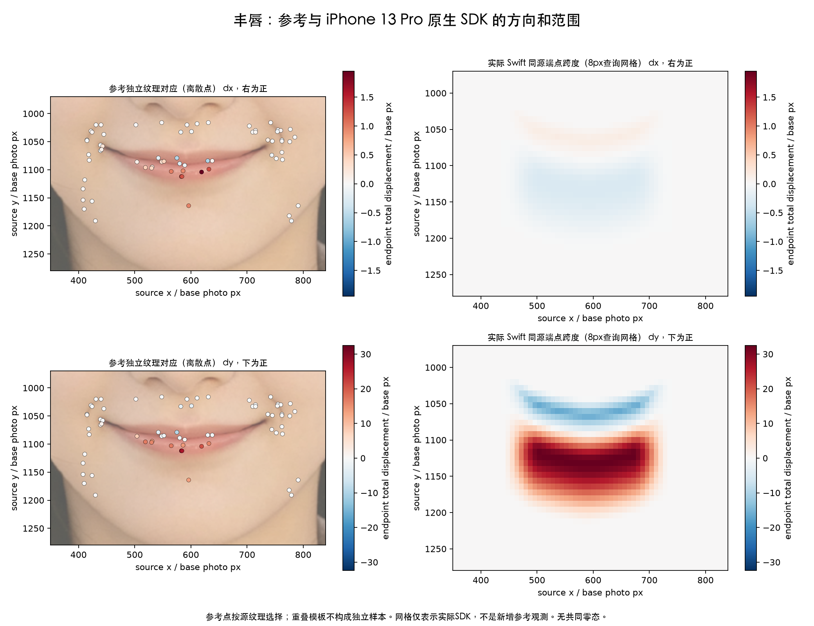
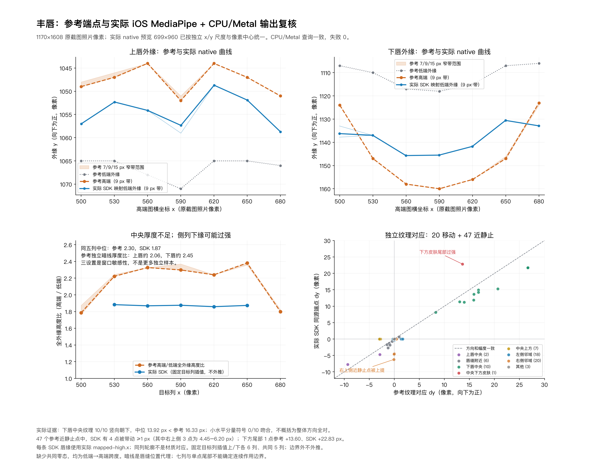
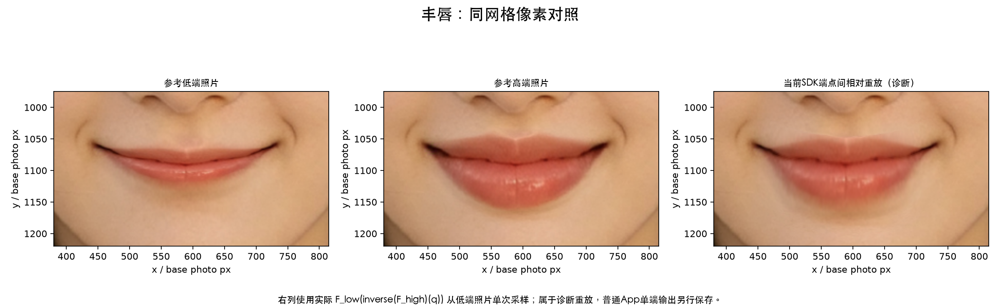

# 丰唇：幅度、方向与作用范围复核

日期：2026-10-17。被核对代码 `c871bfff`。同源比较、像素中心、原生真机路径和执行边界见[本轮公共记录](../M唇与丰唇对照复核.md)。所有幅度为对齐截图照片像素上的低端→高端总差，dy 向下为正，没有共同零态。

**竖向主扩张方向吻合，但中央厚度不足，侧边和下方皮肤部分过强；小水平分量也未复现。** 不能仅统一提高下唇系数。本轮完成对照，未改生产模型。

## 纹理与轮廓分开判断

沿用源纹理选择的缩放 NCC：264 个候选接受 67 个，其中活动 20、近静止 47；拒绝和扩大搜索记录见[分析链路](分析链路.md)。普通固定尺度 NCC 虽有 215 个接受点，却仅两个活动点，不作为唇核心精度证据。DIS 光流的唇部闭合 P95 为 20.31 px，不能用其稠密峰值调幅。

另以七条固定列的上下唇缘做形状检查，保留 7/9/15 px 三个横向带宽及平滑变化。42 条形状查询是敏感性检查，不是 42 个额外材质对应。参考高端同列形状没有提供 dx；SDK 把源边缘点映到高端后，先按实际映后 x 构成曲线，再插值到参考高端列，禁止超出已有曲线范围外推。所有缺覆盖项保留，未按残差删去。

## 方向和核心幅度

| 源纹理分区 | 接受数 | 参考 dy | 当前 SDK dy | 判断 |
| --- | ---: | ---: | ---: | --- |
| 中央上唇 | 2 | −9.30…−2.87 | −7.72…−4.73 | 两点均向上，但样本不足以概括整片上唇 |
| 近唇缝 | 6 | −1.45…+0.93 | −2.66…+0.63 | 相对弱带保留，上移部分偏强 |
| 中央下唇 | 10 | +8.28…+26.70，中位 +16.33 | +8.16…+21.77，中位 +13.92 | 10/10 向下；逐点都偏弱 |

下唇十点的参考 dx 全为正，范围 +0.12…+1.95、中位 +0.97 px；SDK 全为小负值，约 −0.20…−0.08、中位 −0.13 px。因此只能说竖向主方向符合，不能说二维方向完全一致。该弱正交差异应继续区分嘴轴定位、保持局部横坐标的候选约束及匹配不确定性，不能直接加一个未经交叉验证的横向平移常数。

## 外缘形状与作用范围

9 px／0.8 平滑设置下，中央五列同时具备上下两缘的参考覆盖：

| 形状指标 | 参考 | 当前 SDK | 差异 |
| --- | ---: | ---: | --- |
| 高端外缘间高度／低端高度，中位 | 2.30 | 1.87 | 中央厚度不足 |
| 上外缘位置 | 向上扩张 | 仍不够向上 | 少约 4.75…10.13 px |
| 下外缘位置 | 中央向下扩张更强 | 向下扩张偏平 | 少约 9.95…16.42 px |
| 高端外缘间高度 | — | 偏小 | 少约 15.28…22.42 px |

这不是全唇统一偏弱：一侧观察列的下缘反而多下移约 12.25 px。另一侧下缘因为映后 x 超出七列曲线支持范围，保留原映射但不强行评分。三组定位设置不推翻“中央不足、部分侧边过强”的空间模式；它们的边缘位置敏感性不等于材质对应精度。

外围也出现相反误差：右上侧三个缩放纹理点的参考近静止（dy 约 −0.01…−0.11 px），SDK 却上移约 4.45…6.20 px；邻近固定尺度对应也支持局部过作用。上方中央又有参考约 2.75…2.99 px 上移而 SDK 为零的观察，因此不能整体缩窄上方包络。中央下方一个皮肤观察的参考向下约 13.60 px，SDK 约 22.83 px，多约 9.23 px；该处是局部证据，不扩大为整片下方皮肤的倍率。

## 误差、保护与改造约束

缩放 NCC 的 20 个活动点向量残差 P95 为 5.95 px，47 个近静止点 P95 为 3.39 px；两组分别报告，未用背景稀释活动残差。固定尺度方法的两个活动点 P95 为 14.85 px，仍保留为方法适用性差异。所有残差包括匹配不确定性，不称真值误差。

47 个参考近静止缩放对应中，SDK 位移≥1 px 的有 4 个（右上侧 3 个、近缝 1 个），其中≥3 px 有 3 个、≥5 px 有 1 个。固定尺度方法的 213 个近静止对应中另有一个邻近右上侧点被带动约 3.06 px；两种方法保留各自计数，不合并冒充更多独立样本。

后续应先核对源唇缝、外唇定位与可见轮廓的关系，再分别调整中央上下扩张、沿唇宽的收束及下方皮肤过渡，检验当前常斜率内核与包络是否足够。实际安全缩幅影响两端响应，不能只从标称系数推断幅度；直接增幅可能继续扩大侧边/下方尾，或者触发更强缩幅。应保留完整导数、可逆证书及从原图单次采样，并同时验证纹理、形状与外围。

预选眼、鼻、左右外颊和下巴观察窗在本轮实际输出与相对重放中均保持字节一致。此事实来自实际像素检查；眼窗不在本次下半脸查询网格内，不从网格空覆盖推导眼部保护，更不宣称全脸保护资格。

## 图示

实际原生同源映射与参考仍有上述偏差，最终外观状态保持待验收；本页不把“效果非零”或真机测量入口通过写成参考复现通过。
