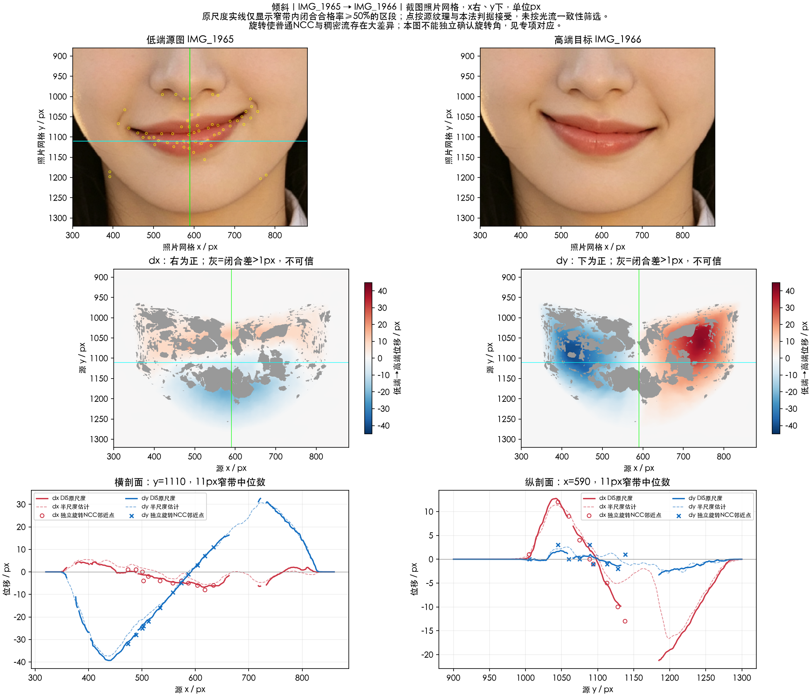
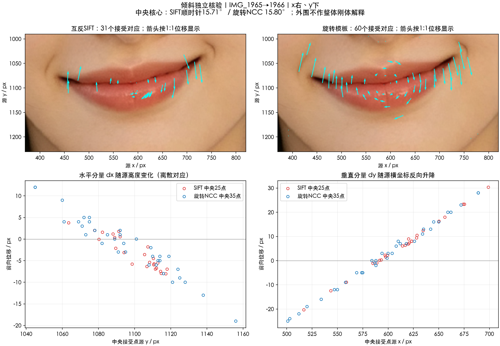

# 嘴巴倾斜

实施状态更新（2026-10-17）：本项已接入 SDK，所有者确认本轮嘴部功能暂定按当前版本收尾；实现、验证范围及尚存差异见[SDK改造记录](../SDK改造记录.md)及[人工验收](../人工验收.md)。这一阶段确认不等于全部参考误差消除，原测量结论保留如下。

分析日期：2026-10-16。输入为 **IMG_1965 → IMG_1966** 的两端截图；这里只测端点跨度，没有共同零态或中间档证据。坐标、单位及输入边界见[嘴唇入口](../README.md)。

口唇中央的独立对应支持约 **15.7–15.8° 顺时针有限旋转**：SIFT 与可旋转模板分别拟合 15.71°、15.80°，中央刚性残差 P95 分别为 0.79、0.72 个对齐截图像素。该数值是两个端点之间的相对转角，不能除二称为单端强度。外围皮肤的运动明显衰减，整片邻域不满足同一刚体。

普通平移模板在旋转控制中出现明显误匹配，本项因此补做独立旋转核验；原稠密场保留作空间估计，不将它或普通 NCC 拟合角度当作真值。

- [分析链路](分析链路.md)：配准、控制、独立对应、竞争机制与未知量。
- [候选实现方案](实现方案.md)：有限旋转核心、二维包络及完整逆映射检查；尚未实施。
- [本地测量说明](本地测量说明.md)：材料身份、重测步骤与保存边界。
- [位移证据](证据/位移证据.png)：对齐端点、带符号位移场和剖面；图像保留在本地。

当前已完成本组截图的几何分析与候选推导；精确支撑边界、中性分拆、滑杆响应及新照片迁移尚未定标。本次没有修改 SDK 或宿主，也没有进行算法效果验收。

