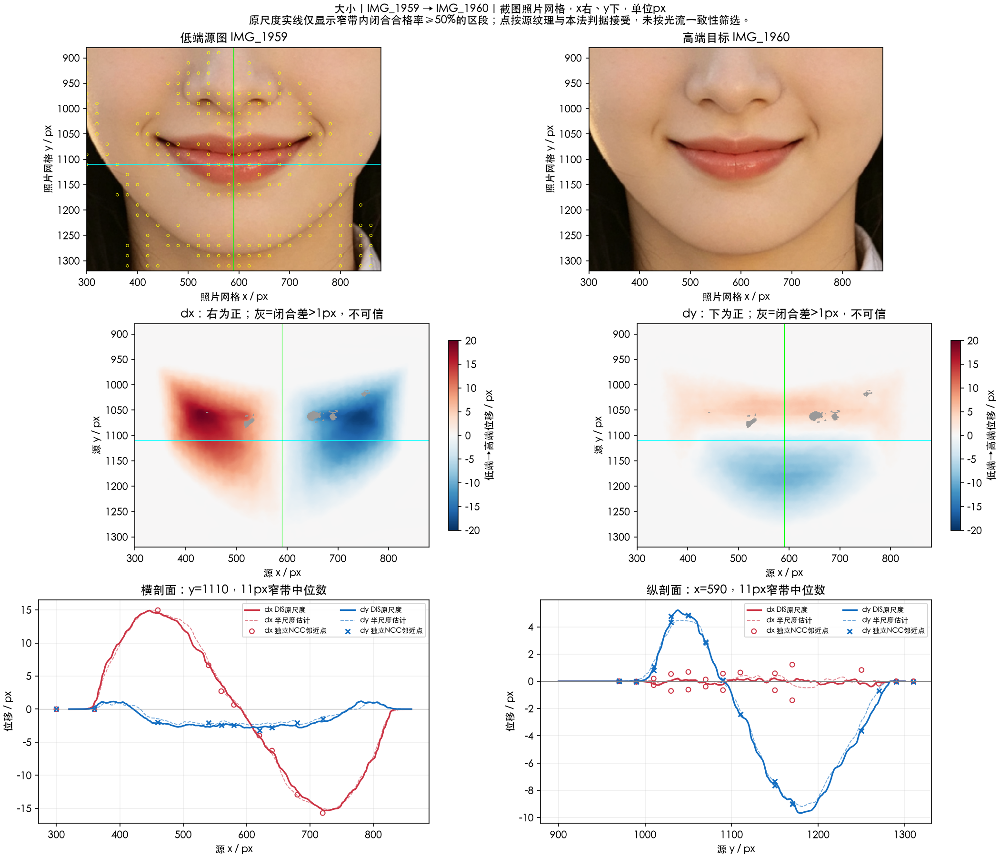

# 嘴唇大小

实施状态更新（2026-10-17）：本项已接入 SDK 候选改造，外观待所有者验收；当前实现与实测限制见[SDK改造记录](../SDK改造记录.md)及[人工验收](../人工验收.md)。原测量结论保留如下。

本轮仅依据 `IMG_1959.PNG → IMG_1960.PNG` 测量“大小”滑杆左端到右端。**右端相对左端收缩**：左侧向右、右侧向左，上部向下、下部向上。界面名称不能替代这个实测方向。

分析日期：2026-10-16。单位均为对齐后的截图像素，`+dx` 向画面右、`+dy` 向下。两图稳定区原字节一致，无须重采样。没有共同中性原图，不能把端点差除二当成单端强度，也不能判断滑杆中间档响应。

| 观测区域 | 独立 NCC 点数 | dx 中位数 | dy 中位数 |
| --- | ---: | ---: | ---: |
| 左侧嘴角邻域 | 10 | +17.13 | +2.49 |
| 右侧嘴角邻域 | 9 | −16.34 | +1.20 |
| 上部唇邻域 | 16 | −0.50 | +2.90 |
| 下部唇邻域 | 16 | −0.03 | −4.24 |

这些是区域纹理点的聚合值，不是某个精确唇缘点的位移。候选机制为以嘴部局部中心为锚的二维收缩，并以连续支撑连接周边皮肤。现有数据支持水平、垂直都收缩，尚不能证明严格等比。

- [分析链路](分析链路.md)：输入、对齐、完整统计、竞争机制与限制。
- [实现方案](实现方案.md)：尚未实施的候选前向场及可推翻它的验证。
- [本地测量说明](本地测量说明.md)：材料与复测边界。
- [公共坐标与采样约定](../实现公共约定.md)。

本轮交付是参考分析与候选方案，未改 SDK，也未获得参考复现、一般照片或完整保护资格。
