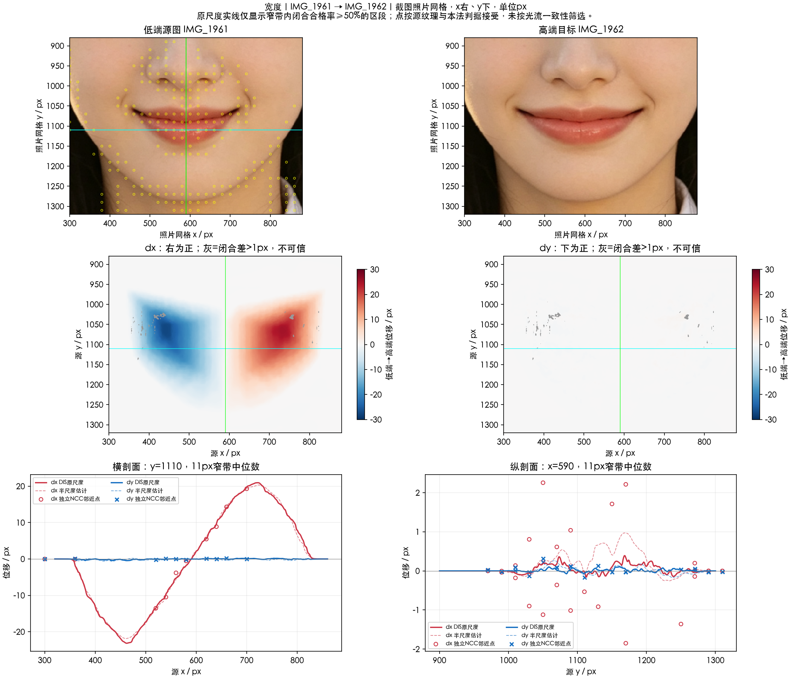

# 嘴唇宽度（整体）

实施状态更新（2026-10-17）：本项已接入 SDK 候选改造，外观待所有者验收；当前实现与实测限制见[SDK改造记录](../SDK改造记录.md)及[人工验收](../人工验收.md)。原测量结论保留如下。

本轮依据 `IMG_1961.PNG → IMG_1962.PNG`，分析“宽度”功能当前可见的**整体**模式。右端相对左端向两侧扩张；垂直变化远小于水平变化。界面没有其他子模式的输入，不扩展到上唇或下唇单独宽度。

分析日期：2026-10-16。单位为对齐后的截图像素，`+dx` 向右、`+dy` 向下。两图稳定区原字节一致，测量保留原网格。没有共同中性原图，端点差不等于单端强度。

| 观测区域 | 独立 NCC 点数 | dx 中位数 | dy 中位数 |
| --- | ---: | ---: | ---: |
| 左侧嘴角邻域 | 7 | −26.05 | −0.19 |
| 右侧嘴角邻域 | 9 | +22.86 | +0.09 |
| 中央唇邻域 | 17 | −0.36 | +0.10 |

候选机制为以中央锚线为参考的局部水平伸展，加上连接周围静止皮肤的连续支撑。它有实测上的方向依据，仍未证明严格线性、严格对称或唯一内部公式。

- [分析链路](分析链路.md)：对齐、独立对应、竞争模型与保护限制。
- [实现方案](实现方案.md)：尚未实施的候选水平场及验证。
- [本地测量说明](本地测量说明.md)。
- [公共坐标与采样约定](../实现公共约定.md)。

本轮未修改 SDK；文档和测量不能作为参考复现或其他输入的效果资格。
