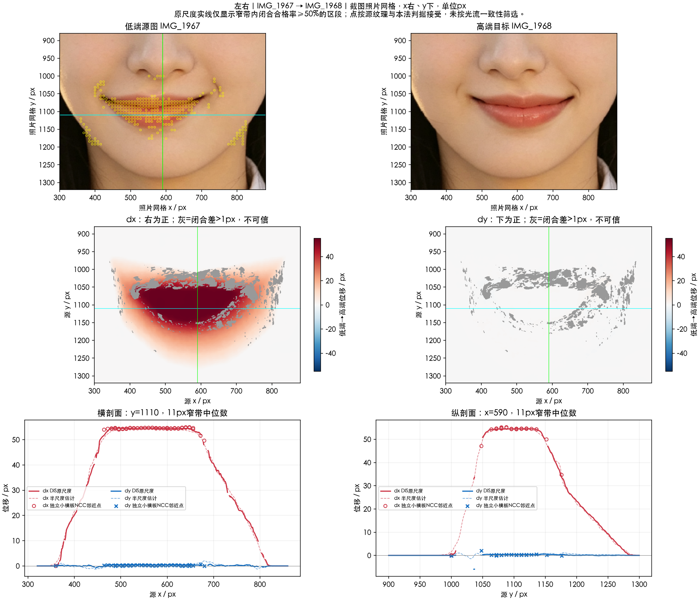

# 左右：核心横移与非对称过渡

实施状态更新（2026-10-17）：本项已接入 SDK，所有者确认本轮嘴部功能暂定按当前版本收尾；实现、验证范围及尚存差异见[SDK改造记录](../SDK改造记录.md)及[人工验收](../人工验收.md)。这一阶段确认不等于全部参考误差消除，原测量结论保留如下。

[返回嘴唇入口](../README.md)。2026-10-16；IMG_1967 最左端→IMG_1968 最右端，没有数值标签或共同零态。

本对下唇核心支持**向右约54.5 px的平台平移**，并带约+0.28 px的微小垂直分量；81个独立小模板对应的平移残差中位0.17 / P95 0.58 px。外围逐渐回落，不能把整个嘴部邻域当刚体，也不能把端点差直接除二作为单端移动量。

- [分析链路](分析链路.md)：原图资格、留出配准、两轮模板、平台与过渡、保护窗及未知量。
- [候选实现方案](实现方案.md)：二维平台平移、独立支撑、标定和可推翻条件；保留原测量阶段推导。
- [本地测量说明](本地测量说明.md)。

像素单位和公共采样约定见[公共约定](../实现公共约定.md)。本图曲线是光流估计，附近小模板点独立筛选；没有把方法间差当成真值误差。
