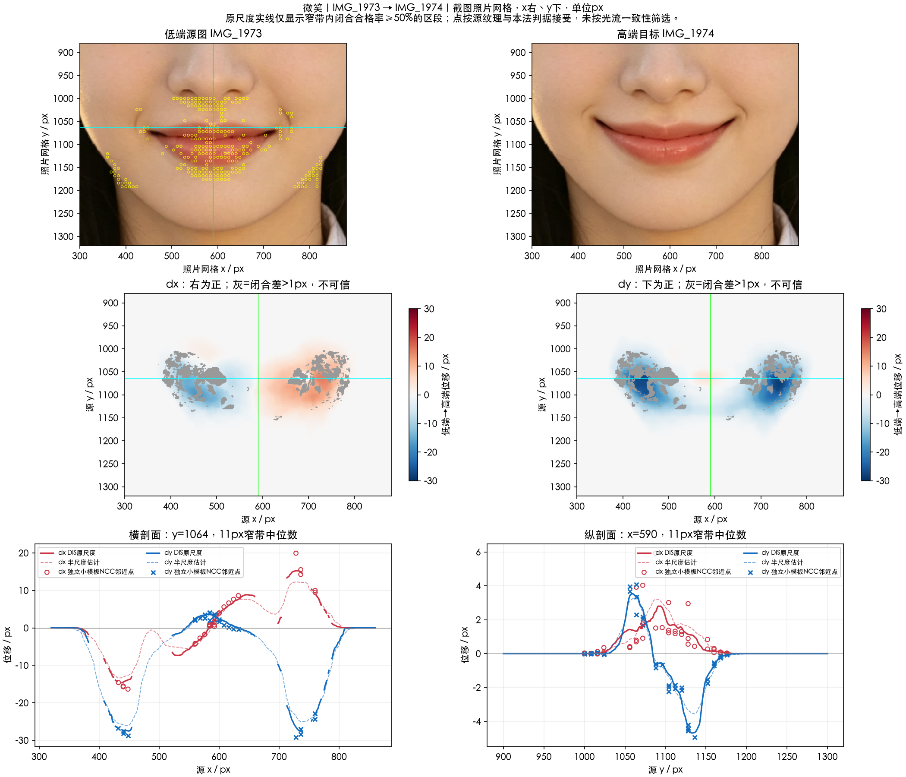

# 微笑：双嘴角上提并外展

实施状态更新（2026-10-17）：本项已接入 SDK 候选改造，外观待所有者验收；当前实现与实测限制见[SDK改造记录](../SDK改造记录.md)及[人工验收](../人工验收.md)。原测量结论保留如下。

[返回嘴唇入口](../README.md)。2026-10-16；IMG_1973最左端→IMG_1974最右端，无数值标签或共同零态。

独立小模板在两嘴角均观察到**上提和外展**：左角检查区dx中位−15.73、dy−28.20 px，右角dx+14.28、dy−28.02 px；中央变化较弱，并有可核验的局部下移。两端都上移且水平分量相反，不能用整个嘴平移、单纯加宽或单一旋转概括。小样本和窗口异质性限制精确峰值结论。

- [分析链路](分析链路.md)：原始与补充对应、残差、保护和未知量。
- [候选实现方案](实现方案.md)：双侧二维局部峰、弱中央反向峰及连续支撑；保留原测量阶段推导。
- [本地测量说明](本地测量说明.md)。

坐标、位移符号和采样见[公共约定](../实现公共约定.md)。这些量均为当前端点总差，未测单端强度。
